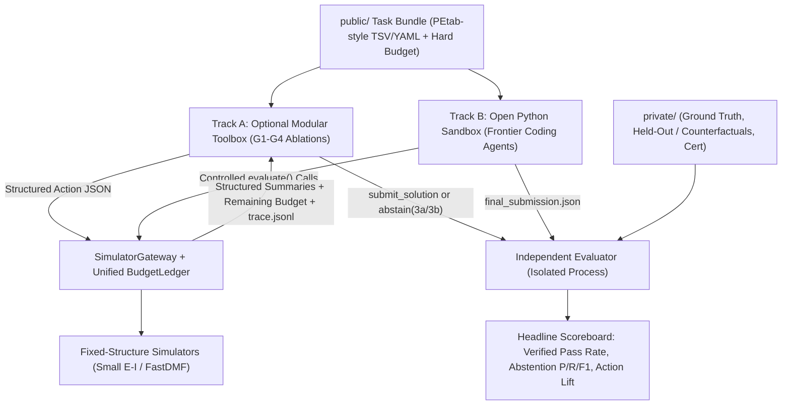

# NeuroDyn-Bench

**An Executable, Cost-Aware Diagnostic Calibration Benchmark and Agent Research Platform for Neural Dynamics Modeling**

---

## Executive Summary

When calibrating mechanistic neural dynamics models (spiking neural networks, neural mass models, and whole-brain connectome models), standard numerical optimizers keep searching blindly, statistical diagnostics stop at passive reports, and frontier LLM agents degrade over long horizons or hallucinate overconfident parameter fits when evidence is insufficient.

**NeuroDyn-Bench** is a **benchmark-first** executable evaluation suite covering three core calibration regimes—**Routine Calibration (Type 1)**, **Recoverable Failures (Type 2)**, and **Evidence-Insufficient / Underdetermined Regimes (Type 3a Non-Identifiable vs. Type 3b Structurally Unreachable)**—under one hard simulation budget. It enables rigorous evaluation of both modular diagnostic-driven controllers (Track A) and open-ended coding agents (Track B) to test whether closing the loop from structured diagnostics to outer-loop search and abstention actions genuinely improves independent validation, scientific honesty, and cost efficiency.

---

## Motivation: Four Core Observations

1. **Higher biophysical realism yields more ill-posed inverse problems**: Moving from single neurons (3–16 parameters) to balanced spiking circuits (8–11 parameters) and whole-brain models (20–100+ parameters) introduces bifurcations, stochasticity, sloppiness, parameter degeneracy, structural/practical non-identifiability, and summary-statistic information loss. Low training error does not imply recovered parameters or reliable counterfactual predictions.
2. **Forty years of diagnostics remain stuck at the reporting layer**: Posterior predictive checks (PPC), Bayesian workflow, simulation-based calibration (SBC), SNOPS feasibility/variance/trade-off signals, and hierarchical validity audits diagnose *what* is wrong, but leave the translation into *what workflow action to take next* to human experts.
3. **Recent scientific agent benchmarks expose the exact capability gap**: AgentHPOBench, HydroAgent, and SimulCost show that frontier LLMs plateau or regress after 3–4 sequential interventions, mis-act on ambiguous logs, ignore simulation costs, and lack principled abstention under insufficient evidence.
4. **No existing neuroscience benchmark covers this niche**: Parameter optimization suites (`Neuroptimus`, `sbibm`, `PEtab`) fix the search setup and compare inner-loop optimizers only; model discovery benchmarks (`BMD`, `ModelSMC`, `NeuronBench`, `unsatz`) search over model equations/structures rather than fixed-structure calibration workflow diagnosis.

---

## Core Architecture: Three-Way Physical Separation and Dual-Track Interface



- **Strict project scope**: Fixed model structure; outer-loop calibration and process diagnosis; executable actions including first-class abstention (`3a_non_identifiable` / `3b_structure_unreachable`); independent verification under fresh seeds and held-out/counterfactual conditions.
- **Four standard control groups**:
  1. **G1 (Raw Optimizer)**: Out-of-the-box BO / CMA-ES under default settings (no diagnostics, never abstains).
  2. **G2 (Expert Rules)**: Deterministic if-else state machine encoding single-cause diagnostic rules.
  3. **G3 (General Tool Agent)**: Frontier LLM with identical tools and raw logs, without structured diagnostic protocols.
  4. **G4 (Diagnostic Calibration Agent)**: Single frontier LLM agent (no task-specific fine-tuning) with structured diagnostic summaries and discriminative probe protocols.

---

## Dual Candidate Environments (Gate 0 Verified)

Both environments are implemented, unit-tested, and empirically profiled on `dgx2felis` (see [`docs/gate0_report.md`](docs/gate0_report.md) and [`configs/budget.yaml`](configs/budget.yaml)):

- **Small E-I Spiking Network (8–10D, CBN / SBN paradigm)**: 1,000-neuron Numba-accelerated LIF network with Dale's law, conduction delays, exponential AMPA/GABA synapses, and all 6 SNOPS population activity statistics (`fr_e`, `ff`, `rsc`, `pct_sh`, `dsh`, `es`). Single-core runtime ~3.09 s (`8.68 sims/s` on 32 workers). Ideal for controlled attribution, stochastic variance, and CBN-vs-SBN structural unreachability (Type 3b).
- **FastDMF Whole-Brain Neural Mass Model (8D–100+D, Schaefer-100 HCP)**: Native `pybind11` C++ binding to canonical `concog/fastdmf` (`DMF.hpp` + Eigen + parallel Balloon-Windkessel BOLD, verified to $10^{-15}$ against upstream reference CSVs). Single-core runtime ~11.19 s (`2.48 sims/s` on 32 workers). Ideal for high-dimensional sloppiness, FC/FCD summary compression, and parameter degeneracy (Type 3a).

---

## Documentation Map

| Document | Scope | Primary Audience |
| --- | --- | --- |
| [`north_star.md`](north_star.md) | Vision, hard scope boundaries, 3 task types x 3 exam levels, stage gates, and stop criteria | All contributors |
| [`HANDOFF.md`](HANDOFF.md) | Project handoff summary, key ADRs, open questions, and archive index | Onboarding & new sessions |
| [`docs/narrative.md`](docs/narrative.md) | Core pitch, audience-tailored framing, competitor boundaries, and 6 reviewer Q&As | PI, paper writing, talks |
| [`docs/architecture.md`](docs/architecture.md) | Three-way separation, PEtab-style task bundle, dual-track toolbox/sandbox, and G1–G4 controls | Engineering & benchmark devs |
| [`docs/rules.md`](docs/rules.md) | Exam syllabus (M1–M4), 6 QA admission gates, budget accounting, anti-gaming metrics, and statistics | Task authors & evaluators |
| [`docs/v0_task_blueprint.md`](docs/v0_task_blueprint.md) | Phase 0 blueprint: T01–T15 benchmark tasks, Gate 0–3 milestones, and team roles | Core execution team |
| [`docs/literature_and_gaps.md`](docs/literature_and_gaps.md) | Synthesis of 21 core papers + 2025–2026 agent/calibration benchmarks and Related Work outline | All contributors & paper |
| [`docs/discussion_log.md`](docs/discussion_log.md) | Design evolution timeline, ADR-001 through ADR-009, and OQ-01 through OQ-07 tracker | Team alignment |
| [`docs/collaborator_brief.md`](docs/collaborator_brief.md) | Alignment checklist and real-case intake template for neuroscience collaborators | Domain collaborators |
| [`docs/primer_for_cs.md`](docs/primer_for_cs.md) | Concise neural dynamics primer for CS/AI contributors (models, ill-posedness, glossary) | CS / AI engineers |
| [`docs/gate0_report.md`](docs/gate0_report.md) | Gate 0 empirical profiling on `dgx2felis`: timings, 32-core scaling, variance, and G1 baseline | Engineering & benchmark devs |
| [`docs/gate1_cert_report.md`](docs/gate1_cert_report.md) | Gate 1 certification report: dual-track harness, 8/8 certified tasks, 3a/3b proofs, and G1/G2 screening | All contributors & paper |

---

## Quick Start

```bash
# 1. Create Python 3.12 environment via uv
uv venv --python 3.12 .venv
uv pip install --python .venv/bin/python -e ".[dev]"

# 2. Build canonical C++ FastDMF pybind11 extension (clones concog/fastdmf automatically)
.venv/bin/python scripts/build_fastdmf.py

# 3. Run test suite (pin BLAS threads to 1 for high-core servers)
OMP_NUM_THREADS=1 OPENBLAS_NUM_THREADS=1 .venv/bin/pytest -v
```

> **Note on `private/` isolation**: Per ADR-006, all `private/` task directories (ground truths, held-out/counterfactual answers, and `validation_cert.yaml`) are excluded from version control via `.gitignore` and regenerated deterministically via `scripts/build_v0_tasks.py` and `scripts/certify_v0_tasks.py`.
