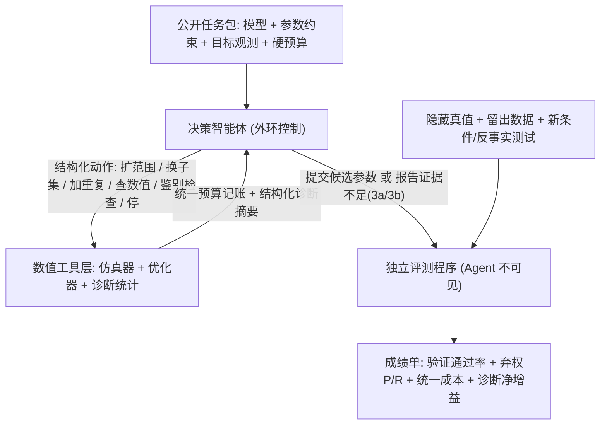

# NeuroDyn-Bench

**神经动力学模型的自动校准与诊断基准（Benchmark-First）与智能体研究平台**  
*Evaluating and Building Diagnostic Calibration Agents for Neural Dynamics Modeling*

---

## 一句话说清这个项目

神经动力学模型（脉冲网络、神经质量模型、全脑模型）参数调不好时，数值优化器只管继续搜，统计诊断只管写报告，前沿 LLM 容易在长程里迷路或强行交卷。

**NeuroDyn-Bench** 要建一个可执行、成本感知、覆盖“常规校准 / 可恢复困难 / 证据不足敢停”三类任务的神经动力学校准极限考场，并以此严格检验：把结构化诊断信号闭环映射到外环决策动作，究竟能不能在固定预算下提升校准可靠性、减少人工排查，并让系统在无解时诚实停下。

---

## 为什么做这件事（四个核心观察）

- **建模越逼真，反问题越病态**：自由参数随尺度增长，伴随强非线性、随机性、参数迟钝性（sloppiness）、退化（degeneracy）、不可辨识与摘要统计量信息损失。拟合误差低不等于参数对。
- **诊断成熟，但没有接上动作**：统计与 SBI 诊断发展了四十年，SNOPS 也提出了工程诊断信号，但输出全停在“哪里不对”的描述层，中间一直靠人翻译成“下一步改什么”。
- **现有 Agent 基准暴露了精准空位**：AgentHPOBench、HydroAgent、SimulCost 等最新基准表明，前沿 LLM 在长程调参中会退化、面对含糊诊断信号会改错参数、忽略仿真成本，且缺乏“证据不足时弃权”的机制。
- **领域内缺少对口的硬基准**：现有神经参数基准（Neuroptimus、sbibm）把任务设置写死、只比内环优化器；机制发现基准（BMD、ModelSMC、NeuronBench、unsatz）搜的是方程结构而非固定结构下的流程诊断。

---

## 核心框架：三部件分离与诊断闭环

- **研究定位钉死**：固定模型结构、只调参数；诊断对象是校准流程；输出是可执行动作（含“停止”）；核心主张是诊断独立改变了决策与结果。
- **四组标准对照**：
  1. **G1 原始优化流程**（BO / CMA-ES / DA / SBI 基线）
  2. **G2 专家规则流程**（将显式诊断表写成确定性规则）
  3. **G3 通用工具智能体**（相同工具，无结构化诊断协议）
  4. **G4 诊断驱动智能体**（主方法）

---

## 候选主环境

首阶段重点考察两类互补环境，前期各完成最小复现并结合领域合作方真实案例确定主辅：

- **小型兴奋–抑制脉冲网络（8–11 维，CBN / SBN 范式）**：落在 BO 舒适区，易于精确构造随机性、分岔、参数退化与结构不可达，适合受控归因。
- **FastDMF 全脑神经质量模型（数十维，C++ 内置 BO）**：直接对接真实全脑活动拟合需求，代表高维昂贵校准的真实硬骨头。

---

## 文档导航

仓库目前处于 **Phase 0**（先定目标、框架、规则与首批样板题，并推进 Gate 0 双环境最小复现），所有设计文档与共识均已沉淀如下：

| 文档 | 解决什么问题 | 建议阅读对象 |
| --- | --- | --- |
| [`HANDOFF.md`](HANDOFF.md) | 完整项目交接总入口：背景、设计方案、关键决定、下一步计划与全套聊天记录/附件索引 | 接手成员 / 新会话 Agent 必读 |
| [`north_star.md`](north_star.md) | 北极星目标：终极愿景、钉死的定位边界、三类任务与三层考场、阶段门控与止损判据 | 全员必读 |
| [`docs/narrative.md`](docs/narrative.md) | 怎么把项目讲清楚：电梯演讲、面向不同受众的表述、与竞品一句话划界、审稿人尖锐质疑应答 | 项目负责人、写稿/汇报 |
| [`docs/architecture.md`](docs/architecture.md) | 系统框架：三部件隔离、类 PEtab 任务包规范、诊断→动作空间、四组对照与防“规则打平”设计 | 算法与工程开发 |
| [`docs/rules.md`](docs/rules.md) | 评测规则与考纲：四模块考纲、反向过筛与标签校验红线、预算/评分/防泄漏/统计纪律 | 出题与评测开发 |
| [`docs/v0_task_blueprint.md`](docs/v0_task_blueprint.md) | Phase 0 落地蓝图：首批 10–15 道标杆样板硬题清单、门控节点与团队分工 | 执行团队 |
| [`docs/literature_and_gaps.md`](docs/literature_and_gaps.md) | 文献脉络与基准横评：21 篇核心文献 + 2025–2026 基准综述 + Related Work 四条主线 | 全员、写论文 |
| [`docs/discussion_log.md`](docs/discussion_log.md) | 思路演进与决策记录（ADR）：前期全部讨论梳理、已定共识与开放问题 | 全员同步 |
| [`docs/collaborator_brief.md`](docs/collaborator_brief.md) | 领域合作方对接清单：三个首要待定问题 + 真实建模案例收集模板 | 发给神经科学合作方 |
| [`docs/primer_for_cs.md`](docs/primer_for_cs.md) | 神经动力学精准入门（CS 视角）：核心概念、三尺度模型、SNOPS/FastDMF 实例与术语表 | 计算机背景队友 |
| [`docs/gate0_report.md`](docs/gate0_report.md) | Gate 0 双环境最小复现实证报告：`dgx2felis` 耗时、32 核并行吞吐、10 种子方差与 G1 基线标定（已解决 OQ-04） | 全员、工程与评测开发 |

---

## 近期最优先的三件事（开工前门控）

在进入大规模系统编码前，先与领域合作方落实以下三点（详见 [`docs/collaborator_brief.md`](docs/collaborator_brief.md)）：

1. 确定首个真实建模困难案例（同步拍板 FastDMF 与小型 E-I 网络的主辅关系）；
2. 明确谁提供对应模型代码、真实数据样例与预处理说明；
3. 共同锁定验收标准（具体指标、达标阈值与交付节点）。
