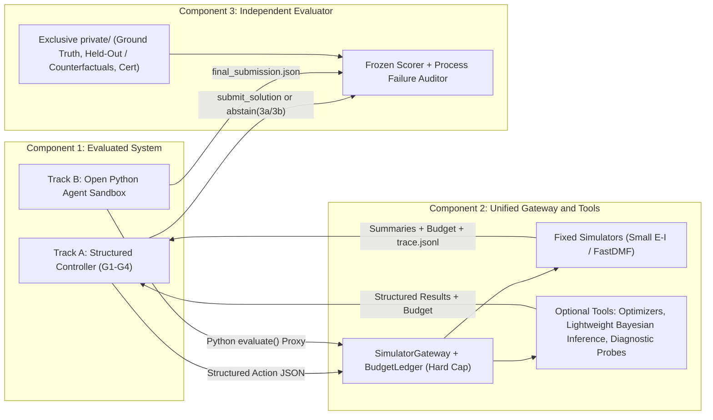

# System Architecture and Engineering Specification

This document specifies the three-way physical isolation architecture, PEtab-inspired task bundle format, unified `SimulatorGateway` + `BudgetLedger`, hybrid dual-track exposure (optional modular toolbox including lightweight Bayesian inference + open Python sandbox), and the four-group experimental controls of **NeuroDyn-Bench**.

---

## 1. Three-Way Physical Separation (ADR-006)

To prevent data leakage, unbilled simulation probes, and drifting evaluation criteria, the codebase enforces strict physical separation across three components:



### Isolation Guarantees

1. **Evaluated Controller / Agent**:
   - Reads only `public/` task files and structured JSON outputs returned by tools or the sandbox proxy.
   - Has **zero access** to `private/` directories, ground truths, held-out/counterfactual observables, or `validation_cert.yaml`.
2. **Unified `SimulatorGateway` and `BudgetLedger`**:
   - Every forward simulation—optimization evaluations, repeated trials ($R$ repeats = $R$ units), short feasibility probes (billed proportionally by duration scale, e.g., `0.2u` for Small E-I, `0.25u` for FastDMF), Bayesian ABC/Laplace/PPC samples, sensitivity screens, and failed/divergent/timed-out runs—is billed through one `BudgetLedger`.
   - Exact `(simulator, params, condition, seed, duration_scale)` cache hits are exempt from double-billing.
   - When budget hits zero, `BudgetExhaustedError` is raised immediately, forcing submission or abstention.
   - Every call appends an immutable audit record to `trace.jsonl`.
   - LLM API calls, token counts, and wall-clock latency are logged separately.
3. **Independent Evaluator**:
   - Runs outside the agent workspace with exclusive read access to `private/`.
   - Evaluates `submit_solution` via fresh-seed replication plus hidden held-out/counterfactual conditions.
   - Evaluates `abstain_insufficient_evidence` against ground-truth task type (`3a` vs. `3b` vs. false abstention on Type 2) and verifies that cited quantitative evidence matches recorded `trace.jsonl` tool calls.

---

## 2. PEtab-Inspired Task Bundle Layout (`public/` vs. `private/`)

Each benchmark task is a self-contained directory split physically into `public/` and `private/`:

```text
tasks/<split>/<task_id>/
├── public/
│   ├── task.yaml                 # Metadata, model type, task prompt (English), disclosure tier
│   ├── parameters.tsv            # name, unit, default_lb, default_ub, phys_hard_lb, phys_hard_ub, scale, nominal, active, description
│   ├── observables.tsv           # obs_id, target_mean, target_sd, weight, tolerance_tau
│   ├── conditions.tsv            # Public experimental conditions (e.g., baseline drive or coupling multiplier)
│   ├── budget.yaml               # Hard max_units B, full unit definition, short_probe_scale
│   └── simulator_config.yaml     # Fixed model structure & numerical defaults (topology, dt, duration, n_repeats)
└── private/                      # Strictly invisible to evaluated systems (gitignored via private/)
    ├── ground_truth.yaml         # True parameters, true task type (type1/type2/type3a/type3b), trap metadata
    ├── heldout_conditions.tsv    # Hidden novel / counterfactual intervention protocols
    ├── heldout_observables.tsv   # Ground-truth held-out target means, SDs, and pass tolerances
    ├── ask_human_oracle.yaml     # Optional oracle responses for information-gap tasks
    └── validation_cert.yaml      # Offline QA proof (Oracle pass rate, G1 screen, 3a/3b certification)
```

### Dual-Bound Semantics and Three-Tier Disclosure

- **Dual bounds in `parameters.tsv`**:
  - `[default_lb, default_ub]`: Initial search box given to default optimizers (may be arbitrarily narrow).
  - `[phys_hard_lb, phys_hard_ub]`: Biophysical hard bounds that must never be violated.
- **Three-tier disclosure renderer (`load_public_task(..., disclosure=...)`)**:
  - `full`: Complete biophysical names, units, descriptions, and dual bounds;
  - `names_only`: Parameter names, units, and bounds without descriptive hints;
  - `blinded`: Parameter names anonymized to `p0, p1, ...` (with reversible mapping held by the gateway) to separate genuine physical reasoning from memorization.

---

## 3. Dual-Track Exposure and Optional Modular Toolbox

The benchmark never hardcodes one solver algorithm. Instead, AI systems discover and compose tools autonomously under `SimulatorGateway`:

### Track A: Optional Modular Tool Registry (`src/neurodyn_bench/tools/`)

- **Inner-loop Optimizers (`optimizers.py`)**:
  - `run_bo`: Optuna TPE / GP Bayesian Optimization with active parameter subset selection and linear/log transforms.
  - `run_cmaes`: CMA-ES supporting optional SNOPS-style short-screen filtering (`short_screen=True`) and adaptive repeat averaging (`n_repeats`).
  - `run_multistart_local`: Budgeted multi-start Nelder-Mead / Powell refinement.
- **Lightweight Budget-Aware Bayesian Inference (`bayesian.py`)**:
  - `run_abc_smc`: Lightweight Sequential Monte Carlo ABC / importance-weighted posterior approximation returning posterior quantiles, pairwise correlations (exposing banana-shaped compensation), and **posterior contraction** $1 - \mathrm{Var}_{\text{post}} / \mathrm{Var}_{\text{prior}}$.
  - `run_laplace_fisher`: Local finite-difference Jacobian / Fisher information eigenspectrum around a candidate $\hat{\theta}$ (costing $\approx d+1$ to $2d$ units), reporting stiff vs. sloppy directions and effective identifiability rank.
  - `run_ppc_audit`: Posterior Predictive Check evaluating an ensemble or approximate posterior across fresh seeds to quantify predictive coverage and systematic feature trade-offs.
- **Discriminative Diagnostic Probes (`diagnostics.py`)**:
  - `boundary_slack`: Detects active-bound saturation and checks slack against `phys_hard` bounds with an outside probe.
  - `repeat_variance`: Runs $R$ repeated seeds at a candidate to separate stochastic variance from deterministic bias.
  - `short_feasibility_scan`: Cheap Latin-hypercube short-horizon scan estimating feasible vs. silent/runaway phase-space fraction.
  - `sensitivity_screen`: One-at-a-time or Morris-style sensitivity screening to separate stiff parameters from sloppy/redundant dimensions.
  - `feature_tradeoff_audit`: Checks whether subsets of observables are individually reachable while jointly conflicting (Type 3b signature).
  - `multistart_identifiability`: Compares distinct low-loss optima in parameter space and variance-normalized separation (Type 3a signature).

### Track B: Open Python Sandbox (`src/neurodyn_bench/gateway/sandbox.py`)

Materializes an isolated run workspace containing only `public/` files, a lightweight `client.py` bound to `SimulatorGateway`, and explicit `submit_solution()` / `abstain_insufficient_evidence()` functions writing `final_submission.json`. Frontier coding agents may write arbitrary Python scripts using installed scientific packages (`numpy`, `scipy`, `cma`, `optuna`, `scikit-learn`, or the optional `neurodyn_bench.tools` helpers), while all simulations remain hard-capped and logged by `BudgetLedger`.

---

## 4. Structured "Symptom -> Discriminative Probe -> Action" Protocol

| Observed Symptom | Competing Hypotheses | Cheap Discriminative Probe | Action After Discrimination |
| --- | --- | --- | --- |
| Best candidate sits on search boundary | Narrow default box **vs.** physical hard bound **vs.** unreachable target | `boundary_slack` (check `phys_hard` + outer step) | Legal slack exists -> expand bounds and re-search; at `phys_hard` -> keep bound and audit trade-offs |
| Noisy objective, top fit fails replication | High stochastic variance **vs.** numerical step instability | `repeat_variance` ($R=5$) + `timestep_check` | Variance-dominated -> increase repeats on elite points (SNOPS-style); numerical drift -> refine `dt` |
| High fraction of silent/runaway failures | Large infeasible phase region **vs.** solver step bug | `short_feasibility_scan` + `timestep_check` | Phase-region issue -> enable short-probe screening or re-center search box |
| High-error plateau across rounds | Ambiguous Type 2 (narrow box + noise) **vs.** bad weights **vs.** Type 3b unreachable | `feature_tradeoff_audit` + `run_ppc_audit` + boundary/variance probes | Recoverable -> fix weights/noise/bounds; irreconcilable feature conflict -> **abstain `3b_structure_unreachable`** |
| Low training error, unstable parameters across runs | Sloppy redundant dims **vs.** strong compensation / representation loss (Type 3a) | `sensitivity_screen` + `run_laplace_fisher` / `run_abc_smc` / `multistart_identifiability` | Redundant dims -> freeze sloppy dims and re-optimize stiff subset; core degeneracy / low posterior contraction -> **abstain `3a_non_identifiable`** |

---

## 5. Four Standard Control Groups (ADR-007)

| Group | Name | Inputs & Tools | Decision Mechanism | Scientific Role |
| --- | --- | --- | --- | --- |
| **G1** | Raw Optimizer | `public/` defaults only | Fixed BO or CMA-ES until budget exhaustion; never abstains | Lower bound of out-of-the-box numerical automation |
| **G2** | Expert Rules | `public/` + full Track A toolbox | Deterministic if-else state machine with fixed thresholds | Tests whether simple rule heuristics suffice |
| **G3** | General Tool Agent | `public/` + Track A tools (same LLM) | Raw numeric logs + tool docs, **no** structured diagnostic protocol | Isolates base LLM tool-calling competence |
| **G4** | Diagnostic Calibration Agent | `public/` + structured diagnostic dashboard + probe protocol | Single off-the-shelf frontier LLM outputting structured hypothesis -> probe/action -> verification | Tests net verified gain of closing the diagnostic loop |

---

## 6. Codebase Layout

```text
NeuroDyn-Bench/
├── pyproject.toml
├── configs/
│   └── budget.yaml
├── data/connectomes/
│   └── DTI_fiber_consensus_HCP.csv
├── src/neurodyn_bench/
│   ├── models/        # base.py, small_ei.py, fastdmf_env.py, _fastdmf_cpp.cpp
│   ├── optim/         # budget.py (BudgetLedger)
│   ├── tasks/         # schema.py, loader.py (PEtab-style bundles + 3-tier disclosure)
│   ├── gateway/       # gateway.py (SimulatorGateway + trace.jsonl), sandbox.py (Track B)
│   ├── tools/         # registry.py, optimizers.py, bayesian.py, diagnostics.py (Track A)
│   ├── agents/        # g1_optimizer.py, g2_rules.py, oracle.py
│   └── eval/          # evaluator.py, metrics.py
├── scripts/           # build_fastdmf.py, gate0_*.py, build_v0_tasks.py, certify_v0_tasks.py
└── tests/             # test_gate0.py, test_gate1.py
```
