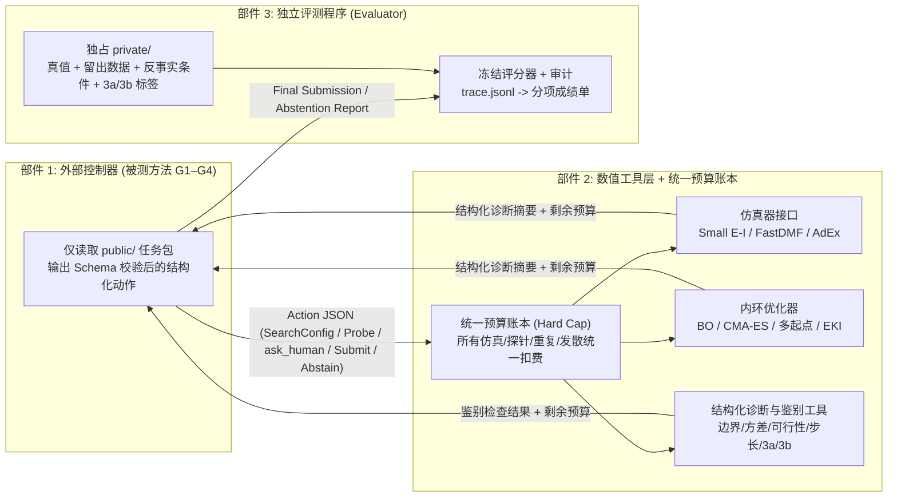

# 系统框架与工程设计（Architecture）

这份文档定义了 **NeuroDyn-Bench** 的三部件物理分离架构、类 PEtab 任务包规范、结构化诊断与动作空间、四组标准对照实现方式，以及防止简单规则（if-else）轻易打平诊断 Agent 的核心设计。

---

## 1. 总体架构：三部件严格物理分离（ADR-006）

为了杜绝数据泄漏、偷跑预算与评分标准漂移，系统在代码与文件目录层面严格拆分为三个彼此隔离的部件：



### 物理隔离红线

1. **外部控制器（被测方法）**：
   - 运行时仅挂载只读 `public/` 任务包与工具返回的 JSON 摘要；
   - **严禁**访问 `private/` 目录、离线标签校验文件（`validation_cert.yaml`）以及留出/反事实测试数据；
   - 不直接输出原始参数猜测去替代优化器（ADR-003），而是通过结构化动作控制内环优化流程、调用鉴别性诊断探针或决定停止。
2. **数值工具层与统一预算账本**：
   - 任何一次仿真调用——包括优化迭代、重复仿真（$R$ 次计 $R$ 单位）、短仿真探针（按仿真步数比例折算，如 10 s / 100 s 记 $0.1$ 单位）、局部敏感性/Fisher 审计、步长检查、发散或超时失败——都必须经过同一 `BudgetLedger` 扣费；
   - 仅对**完全相同的 `(参数向量, 仿真配置, 随机种子)` 缓存命中**不重复计费；
   - 预算触顶时工具层立即熔断拒绝新仿真，迫使控制器进入提交（`submit_solution`）或弃权（`abstain_insufficient_evidence`）；
   - LLM 调用次数、token 与 API 费用独立记录，与仿真预算并列汇报。
3. **独立评测程序（Evaluator）**：
   - 独占 `private/` 目录，在独立进程中执行；
   - 对 `submit_solution`：使用新随机种子复现、核验留出数据与隐藏新条件/反事实干预；
   - 对 `abstain_insufficient_evidence`：核验任务真实标签（3a vs 3b vs 误停 Type 2）、亚型判断是否一致、以及是否附带来自工具层的有效量化证据；
   - 评分阈值与规则在评测前冻结，不随任何 Agent 动作变化。

---

## 2. 类 PEtab 任务包规范（`public/` vs. `private/`）

借鉴系统生物学 `Benchmark-Models-PEtab` 的标准化思想，每个任务是一个自包含目录，严格划分为公开部分与私有部分：

```text
tasks/<split>/<task_id>/
├── public/
│   ├── task.yaml                 # 任务元数据、模型标识、信息披露档位 (full / names_only / blinded)
│   ├── parameters.tsv            # 参数卡：name, unit, default_lb, default_ub, phys_hard_lb, phys_hard_ub, scale, nominal, description
│   ├── observables.tsv           # 目标统计量定义：obs_id, metric_type, target_mean, target_sd, weight, tolerance_tau
│   ├── conditions.tsv            # 公开实验条件表（如注入电流、外部输入率、SC 矩阵路径）
│   ├── budget.yaml               # 硬预算上限 B、单次完整仿真单位定义、短探针折算系数、允许工具清单
│   └── simulator_config.yaml     # 固定模型结构与默认数值设置（dt、仿真时长、burn-in、默认重复数 R）
└── private/                      # 对所有被测方法完全不可见，仅 Evaluator 可读
    ├── ground_truth.yaml         # 合成题真值参数（或真实数据来源元信息）、隐藏难度类型 (Type 1/2/3a/3b)
    ├── heldout_conditions.tsv    # 留出条件 / 反事实干预协议（改变 E/I、通道阻断、新刺激/新被试）
    ├── heldout_observables.tsv   # 留出与反事实条件的目标观测及验收阈值
    ├── ask_human_oracle.yaml     # 仅用于含信息缺口题目（如 T10）的受控人工问答应答表
    └── validation_cert.yaml      # 离线标签校验证明（Oracle 多 seed 通过率 / 3a 退化证明 / 3b ≥10×预算不可达证明）
```

### 参数卡中的双边界语义（关键设计）

`parameters.tsv` 显式区分两层边界：

- **默认搜索盒 `[default_lb, default_ub]`**：任务初始给优化器的搜索范围，可能因人为拍脑袋设窄而卡住真值；
- **生理硬边界 `[phys_hard_lb, phys_hard_ub]`**：由神经生物学定律决定的不可逾越边界（例如电导/连接概率非负、时间常数生理下界、Dale 定律符号约束）。

这一区分直接支撑对“物理语义判断”的考核：贴边时，控制器必须核对贴的是默认搜索盒边界（合法可扩）还是生理硬边界（禁止越界）。

---

## 3. 结构化诊断协议与动作空间（核心资产）

### 3.1 统一结构化动作 Schema

外部控制器每一轮必须输出一条经 JSON Schema 校验的决策对象（包含 `hypothesis`、`evidence_refs`、`action_type`、`action_params`）：

| 动作类别 | `action_type` | 核心参数 | 预算计费 |
| --- | --- | --- | --- |
| **优化执行** | `run_optimizer` | `optimizer` (`bo` / `cmaes` / `random` / `multistart`), `active_params`, `bounds`, `scales` (`lin`/`log`), `n_evals`, `n_repeats`, `short_screen` | 按实际有效仿真单位扣费 |
| **鉴别探针** | `run_diagnostic_probe` | `probe_type`: `repeat_variance` / `boundary_slack` / `timestep_check` / `short_feasibility_scan` / `sensitivity_screen` / `multistart_identifiability` / `feature_tradeoff_audit` | 全部计入统一仿真预算 |
| **配置更新** | `update_search_config` | 调整活动参数子集、合法放宽搜索范围、切换线性/对数尺度、归一化多特征权重、修改积分步长 `dt` 或可行性筛子 | 0 仿真单位（纯配置） |
| **受控提问** | `ask_human` | `topic`, `question`（仅用于信息缺口题，多余提问在评价中扣分） | 计入人工介入次数 |
| **提交参数** | `submit_solution` | `theta_hat`, `uncertainty_notes`, `verification_summary` | 终止运行 |
| **主动弃权** | `abstain_insufficient_evidence` | `subtype` (`3a_non_identifiable` / `3b_structure_unreachable`), `conflict_or_sloppy_evidence`, `recommended_next_data` | 终止运行 |

### 3.2 “现象 → 鉴别性检查 → 动作”闭环表

为了避免“看到停滞就盲猜原因”，协议强制在**现象**与**流程修改/停止**之间插入**廉价鉴别性检查**：

| 观测现象（来自上一轮摘要） | 可能的混淆原因 | 推荐鉴别性检查（先判后改） | 判清后的可执行动作 |
| --- | --- | --- | --- |
| 最优候选持续贴近搜索边界 | 默认范围设窄 **vs.** 触及生理硬边界 **vs.** 目标不可达把参数推向极端 | `boundary_slack`：核对 `phys_hard` 边界 + 外侧小步探针 | 合法空间有余量 → 扩范围重搜；触及生理硬界 → 固定或转查模型/特征冲突 |
| 拟合误差震荡、好解复现不上 | 随机仿真方差过大 **vs.** 数值步长偏大导致隐性不稳定 | `repeat_variance`（同点 $R=5$ 次复测）+ `timestep_check`（`dt/2` 对比） | 复测方差主导 → 高潜力点加大重复（SNOPS 式）；步长偏移 → 降 `dt` 重校 |
| 大片样本失败/发散/全网沉默 | 搜索盒覆盖大面积非生理相区 **vs.** 积分步长或初值 bug | `short_feasibility_scan`（短时长探针）+ `timestep_check` | 确认为相区问题 → 启短仿真可行性筛子或 E/I 比值重参数化 |
| 误差降到高位后持续停滞 | 范围窄 + 噪声叠加（可解 Type 2） **vs.** 多目标量纲失衡 **vs.** 固定结构不可达（Type 3b） | `feature_tradeoff_audit`（单/子集特征可达性检查）+ 宽域探针 | 单特征权重失衡 → 归一化重配权；局部+群体特征硬冲突且宽域无解 → **停止并报 3b** |
| 训练误差很低，但多次独立优化参数差异巨大 | 维度过高含迟钝参数 **vs.** 强参数补偿/表征压缩信息损失（Type 3a） | `sensitivity_screen` + `multistart_identifiability`（局部 Fisher / 多起点分离度） | 仅少数冗余维度 → 固定迟钝参数聚焦刚性子集；主目标本身多解等价且反事实风险高 → **停止并报 3a** |

---

## 4. 四组标准对照与“防规则打平”设计（ADR-007）

| 对照组 | 名称 | 权限与输入 | 决策机制 | 科学对照目的 |
| --- | --- | --- | --- | --- |
| **G1** | 原始优化器基线 | 仅 `public/` 默认配置 | 固定跑完预算的 BO / CMA-ES / 多起点优化，无诊断、从不弃权 | 测现有自动化数值工具的真实上限 |
| **G2** | 专家规则基线 | `public/` + 全部诊断工具 | 将上述诊断表写成确定性 if-else 状态机（固定阈值与优先级） | 检验收益是否仅靠廉价确定性规则就能拿到，防“杀鸡用牛刀” |
| **G3** | 通用工具 Agent | `public/` + 全部工具（同 LLM 底座） | 仅给原始运行日志与工具说明书，**无**结构化诊断摘要与“先鉴别后行动”协议 | 剥离“LLM 本身会调工具”的基线效应，衡量结构化诊断协议的净贡献 |
| **G4** | 诊断驱动 Agent（主方法） | `public/` + 结构化诊断仪表盘 + 鉴别协议 | 单智能体 + 现成前沿 LLM（首版不微调），每轮强制输出“假设 → 鉴别检查/动作 → 证据复核” | 检验结构化诊断闭环是否独立改变动作、提升验证通过率与 3a/3b 科学诚实度 |

### 专门防“简单 if-else 打平 LLM”的三类设计

1. **多因一果歧义停滞**（如 T08）：单一阈值规则无法区分“范围略窄 + 噪声大”与“结构不可达”，必须按剩余预算先选最便宜的鉴别探针排除假说；
2. **物理硬边界与参数语义判断**（如 T03、T09）：参数名、单位与生物物理约束决定哪些维度允许放宽、参数补偿时该先锚定哪组慢变量/次要参数；
3. **残余预算下的动态权衡**：在预算仅剩 20%–30% 时权衡“继续加重复降方差”、“缩减到刚性子集精搜”还是“提前停机报告不确定性”。

同时坚持 **ADR-009 诚实底线**：若封闭测试显示 G2 规则已足够强、G4 并无稳定净增益，则诚实报告这一能力边界。

---

## 5. 代码仓库工程布局规划

```text
NeuroDyn-Bench/
├── pyproject.toml                     # uv / Python 3.12 依赖与包配置
├── configs/
│   └── budget.yaml                    # 基于 dgx2felis 实测耗时的预算档位与代价扫描配置
├── src/neurodyn_bench/
│   ├── models/                        # 仿真器统一接口
│   │   ├── base.py                    # Simulator 抽象接口与标准化 SimulationResult
│   │   ├── small_ei.py                # 候选环境一：Small E-I 脉冲网络 (CBN/SBN + 6 项 SNOPS 统计量)
│   │   ├── fastdmf_env.py             # 候选环境二：FastDMF 全脑神经质量模型 (C++ 核心封装 + FC/FCD)
│   │   └── adex.py                    # 锚题载体：AdEx 单神经元模型
│   ├── tasks/                         # 类 PEtab 任务包加载、校验与生成器
│   ├── optim/                         # 内环优化器封装（BO / CMA-ES / 多起点）与 BudgetLedger
│   ├── diagnostics/                   # 结构化诊断信号与鉴别性探针库
│   ├── agents/                        # G1 / G2 专家规则 / G3 通用 Agent / G4 诊断 Agent
│   └── eval/                          # 独立评测器、防刷分指标计算与 trace.jsonl 审计
├── scripts/                           # Gate 0 最小复现、离线标签校验、批量评测脚本
└── tests/                             # 单元测试（预算硬截断、隔离性、仿真器可复现性）
```
