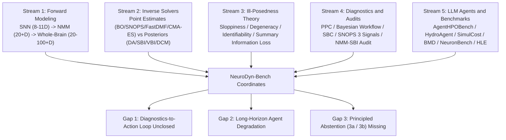

# Literature Landscape, Benchmark Comparison, and Research Positioning

This document synthesizes the project's **21 foundational neuroscience/statistics references** together with **2024–2026 calibration and scientific agent benchmarks** to ground Related Work and prevent reinvention.

---

## 1. Five Research Streams Converging on Three Gaps

### 1.1 Forward Modeling Paradigms (Growing Dimensionality)

| Scale | Representative Models | Typical Free Params | Key References |
| --- | --- | --- | --- |
| **Single neuron** | Hodgkin–Huxley, AdEx, detailed CA1 | 3–16 | Hodgkin & Huxley 1952; Mohácsi et al. 2024 |
| **Spiking circuit (SNN)** | Classical / Spatial Balanced Networks (CBN / SBN) | 8–11 | van Vreeswijk & Sompolinsky 1996; Brunel 2000; Wu et al. 2024 (SNOPS) |
| **Neural mass (NMM)** | Wilson–Cowan, Jansen–Rit, Wendling | 10–20+ | Wilson & Cowan 1972; Jansen & Rit 1995; Wendling et al. 2002 |
| **Whole-brain network** | DMF, reduced Wong–Wang, FastDMF | 20–100+ | Deco et al. 2014; Herzog et al. 2024; Wischnewski et al. 2025 |
| **Low-D manifold reparam** | pDMF (264 params compressed to 9D) | 9 | Ziaeemehr et al. 2025 (VBI) |

### 1.2 Inverse Solvers: Point Estimation vs. Posterior Inference

- **Point-estimate optimization (sample-efficient, no direct uncertainty)**:
  - **Bayesian Optimization (BO)**: **SNOPS** (Wu et al. 2024, *Nature Computational Science*) is the flagship spiking-network pipeline, embedding three diagnostic-like engineering heuristics—10 s short feasibility screening, adaptive repeat sampling on promising candidates, and Factor Analysis population covariability statistics (`%sh`, `dsh`, `es`)—yet still costs ~168 core-hours per full customization; **FastDMF** (Herzog et al. 2024, *Network Neuroscience*) bundles C++ DMF + analytic FIC + BO; Wischnewski et al. 2025 (*PLoS ONE*) push whole-brain BO/CMA-ES to 103D across 272 subjects.
  - **Evolutionary strategies (CMA-ES / PSO)**: **Neuroptimus** (Mohácsi et al. 2024, *PLoS CB*) compares 20+ algorithms across 6 single-cell tasks, confirming CMA-ES and PSO are most reliable while local search fails on complex tasks.
  - **GP-BO ceiling**: Standard GP-BO shines around 8–11D; higher dimensions require sensitivity screening, subspace projection, or alternative surrogates.
- **Posterior inference (uncertainty-aware, compute-intensive)**:
  - **Data Assimilation (EnKF / HDA)**: Sequential online state-parameter tracking.
  - **Simulation-Based Inference (SBI / VBI)**: VBI (Ziaeemehr et al. 2025) trains neural density estimators on ~50k simulations, exposing banana-shaped $(G, J)$ non-identifiability directly—prohibitive under tight 100–200-sim budgets when single runs take 10–370 s.
  - **Variational Bayes / DCM**: Friston et al. 2003; Dynamics-Informed Priors (Caccamo et al. 2026).

### 1.3 Root Causes of Ill-Posedness (Good Fit != True Parameters)

| Concept | Physical / Statistical Meaning | Key Evidence |
| --- | --- | --- |
| **Sloppiness** | Parameter sensitivities span orders of magnitude (few stiff directions, many sloppy ones) | Gutenkunst et al. 2007 (*PLoS CB*) |
| **Degeneracy** | Disparate circuit parameter sets yield nearly identical activity | Prinz et al. 2004; Marder & Goaillard 2006 |
| **Identifiability** | Structural vs. practical non-identifiability; only 1 of 22 NMM parameters (inhibitory decay rate) was directly identifiable from 82 EEG spectra | Hartoyo et al. 2019 (*PLoS CB*) |
| **High-D reliability inversion** | Expanding from 2–3 global to 103 regional parameters raises goodness-of-fit while degrading run-to-run parameter reliability | Wischnewski et al. 2025 (*PLoS ONE*) |
| **Summary compression loss** | Summary statistics can discard information required to distinguish mechanisms; failures must separate model mismatch from representation loss | Cai et al. 2026 (`arXiv:2607.24874`) |

### 1.4 Diagnostics and Agent Capability Frontier

- **Mature passive diagnostics**: PPC (Rubin 1984; Gelman et al. 1996), Bayesian Workflow (Gelman et al. 2020), SBC (Talts et al. 2018), SNOPS three signals (feasibility, cost variance, trade-off cost), and NMM-SBI Audit (Cai et al. 2026). None closes the loop into executable workflow actions.
- **Model structure discovery (boundary references)**: `BMD` (Yuh et al. 2026, `arXiv:2610.25747`), `ModelSMC` (Wahl et al., ICML 2026), `NeuronBench / MDA` (Murphy, `arXiv:2608.09696`), `unsatz` (`arXiv:2611.03713`).
- **Frontier agent failure evidence**:
  - **AgentHPOBench** (Huai et al. 2026, `arXiv:2607.29626`): 30 executable ML tasks, 12 agents—useful early interventions plateau/regress from round 4 onward due to noisy logs and ambiguous signals.
  - **HydroAgent** (`arXiv:2605.17792`): 9 frontier LLMs calibrating distributed hydrologic models fail to match human experts, exhibiting premature stopping, out-of-bounds proposals, and diagnosis-action misalignment.
  - **SimulCost** (Cao et al., ICML 2026): Cost-aware physics simulator tuning—multi-round LLMs reach 66–81% success but run 1.5–2.7x slower than scanning once simulation costs are counted.
  - **Physics-labeled prompting** (`arXiv:2610.22379`): Physical diagnostic prompts help strongly in the first 5 runs (21.9x lower median error) but match ablated prompts by run 15, with 9.8x cross-seed median variance.

---

## 2. Cross-Benchmark Comparison Matrix

| Benchmark / System | Domain & Scale | Tests Setup? | Multi-Round Diagnosis -> Action? | Paired 3a / 3b Abstention? | Unified Sim + LLM Cost? | Human-Intervention Proxy? |
| --- | --- | --- | --- | --- | --- | --- |
| **Neuroptimus (2024)** | Neuro single-cell (6) | No | No (inner optimizer only) | No | Evals only | No |
| **sbibm (2021)** | Generic toy posteriors (10) | No | No | No | Sims only | No |
| **PEtab Benchmarks (2019)** | Systems biology ODEs (20) | No (great schema) | No | No | No | No |
| **BBOWP-Bench (2026)** | Cross-domain BBO (23) | Yes (3 tiers) | No (single-shot) | No | No | No |
| **AgentHPOBench (2026)** | ML HPO (30) | Partial | Sequential interventions | No | Partial | No |
| **TuneBench (2026)** | Power grid dynamics (2) | Partial | Multi-round (randomized GT) | No | 15-sim cap | No |
| **HydroAgent (2026)** | Hydrologic models (4) | Partial | Multi-round (3 failure modes) | No | Wall + rounds | Expert score only |
| **SimulCost (ICML 2026)** | Physics simulators (11) | No | Multi-round | No | Yes (analytic) | No |
| **NeuronBench / MDA (2026)** | Single-cell HH (6) | No | Active experiment + discovery | No | Exp budget | No |
| **ModelSMC / BMD / unsatz** | Structure discovery | No | Equation/structure search | No | Model evidence | No |
| **Humanity's Last Exam** | Static QA (2500) | N/A | N/A | Confidence calibration | N/A | N/A |
| **NeuroDyn-Bench (Ours)** | **SNN + Whole-Brain** | **Yes (3 tiers)** | **Yes (Dual-Track + Probes)** | **Yes (3a/3b + 1:1 controls)** | **Yes (full + scan)** | **Yes (proxy + `ask_human`)** |

---

## 3. Core References

- Wu, S. et al. (2024). Automated customization of large-scale spiking network models to neuronal population activity. *Nature Computational Science*, 4, 690–705. (SNOPS)
- Herzog, R. et al. (2024). Neural mass modeling for the masses: Democratizing access to whole-brain biophysical modeling with FastDMF. *Network Neuroscience*, 8(4), 1590–1612.
- Huai, T. et al. (2026). AgentHPOBench: A Benchmark For Evaluating LLM Agents as Sequential Hyperparameter Optimizers. `arXiv:2607.29626`.
- Yuh, J. et al. (2026). Bayesian Model Discovery with Language Models. `arXiv:2610.25747`.
- Hartoyo, A. et al. (2019). Parameter estimation and identifiability in a neural population model for electro-cortical activity. *PLoS Comput Biol*, 15(5), e1006694.
- Gutenkunst, R. N. et al. (2007). Universally sloppy parameter sensitivities in systems biology models. *PLoS Comput Biol*, 3(10), e189.
- Prinz, A. A., Bucher, D., & Marder, E. (2004). Similar network activity from disparate circuit parameters. *Nature Neuroscience*, 7(12), 1345–1352.
- Marder, E., & Goaillard, J.-M. (2006). Variability, compensation and homeostasis in neuron and network function. *Nature Reviews Neuroscience*, 7(7), 563–574.
- Cai, T. et al. (2026). A Hierarchical Validity-Audit Framework for Neural Mass Models in Simulation-Based Inference. `arXiv:2607.24874`.
- Deco, G. et al. (2014). How local excitation-inhibition ratio impacts the whole brain dynamics. *J. Neurosci.*, 34(23), 7886–7898.
- Wischnewski, K. J. et al. (2025). Exploring dynamical whole-brain models in high-dimensional parameter spaces. *PLoS ONE*, 20(5), e0322983.
- Ziaeemehr, A. et al. (2025). Virtual Brain Inference (VBI). *bioRxiv* `10.1101/2025.01.21.633922`.
- Mohácsi, M. et al. (2024). Evaluation and comparison of methods for neuronal parameter optimization using the Neuroptimus software framework. *PLoS Comput Biol*, 20(12), e1012039.
- Hass, H. et al. (2019). Benchmark problems for dynamic modeling of intracellular processes (PEtab). *Bioinformatics*, 35(17), 3073–3082.
- Gelman, A. et al. (2020). Bayesian Workflow. `arXiv:2011.01808`.
- Talts, S. et al. (2018). Validating Bayesian inference algorithms with simulation-based calibration. `arXiv:1804.06788`.
- Cao, Y. et al. (2026). SimulCost: A Cost-Aware Benchmark and Toolkit for Automating Physics Simulations with LLMs. *ICML 2026* (PMLR 306).
- HydroAgent (2026). Closing the Gap Between Frontier LLMs and Human Experts in Hydrologic Model Calibration via Simulator-Grounded RL. `arXiv:2605.17792`.
- Physics-Labeled Prompting for Budgeted Engineering Simulator Calibration (2026). `arXiv:2610.22379`.
- Murphy, K. (2026). Model Discovery Agent & NeuronBench. `arXiv:2608.09696`.
- Wahl, S., Gedon, D., & Macke, J. (2026). ModelSMC. *ICML 2026* (PMLR 306).
- Phan, L. et al. (2025/2026). Humanity's Last Exam & HLE-Rolling. `arXiv:2501.14249`.
