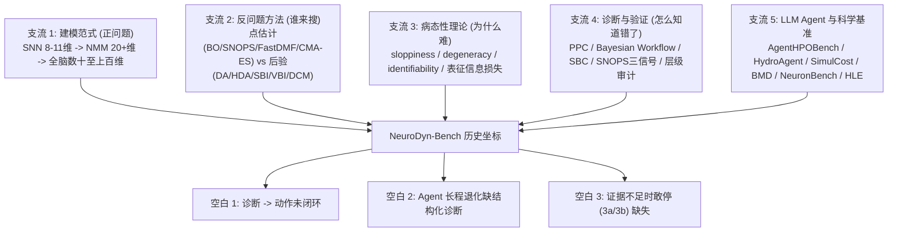

# 相关工作脉络、现有基准横评与研究坐标（Literature & Gaps）

这份文档融合了团队前期整理的 **21 篇核心文献脉络** 与 **2025–2026 年跨领域校准及科学 Agent 基准调研**，用于支撑项目定位、防止重复造轮子，并可直接作为论文 Related Work 的结构底稿。

---

## 1. 相关工作的六条支流与三处空白

### 1.1 建模范式：参数维度单向递增

| 尺度 | 代表模型 | 参数维度 | 代表文献 |
| --- | --- | --- | --- |
| **单神经元** | Hodgkin–Huxley、AdEx、形态精细多室 CA1 | 3–16 | Hodgkin & Huxley 1952；Mohácsi et al. 2024 |
| **微观脉冲网络** | 经典平衡网络（CBN）、空间平衡网络（SBN） | 8–11 | van Vreeswijk & Sompolinsky 1996；Brunel 2000；Wu et al. 2024（SNOPS） |
| **介观神经质量** | Wilson–Cowan、Jansen–Rit、Wendling | 10–20+ | Wilson & Cowan 1972；Jansen & Rit 1995；Wendling et al. 2002 |
| **宏观全脑网络** | DMF、reduced Wong–Wang、FastDMF | 数十至上百 | Deco et al. 2014；Herzog et al. 2024；Wischnewski et al. 2025 |
| **低维流形重参** | pDMF（264 参数降至 9 维） | 9 | Ziaeemehr et al. 2025（VBI） |

核心矛盾：模型越贴近生物真实，自由参数越多，从宏观/部分观测倒推微观参数的反问题就越病态。

### 1.2 反问题方法：点估计与后验的分岔

- **点估计路线（快，但不直接提供不确定性）**：
  - **贝叶斯优化（BO）**：**SNOPS**（Wu et al. 2024, *Nature Computational Science*）是目前脉冲网络定制最完整的工程实现，核心包含三个本质上属于诊断的技巧——10 秒短仿真筛除不可行区、只对高潜力候选增加重复以压方差、在代价函数中引入因子分析群体统计量（`%sh`、`dsh`、`es`），全量定制仍需约 168 单核小时；**FastDMF**（Herzog et al. 2024, *Network Neuroscience*）将 BO 内置进 C++ 全脑仿真器，开箱即可作基线；Wischnewski et al. 2025（*PLoS ONE*）在 272 名被试上把优化推到 103 维。
  - **演化策略（CMA-ES / PSO / IBEA）**：**Neuroptimus**（Mohácsi et al. 2024, *PLoS CB*）在 6 个单细胞基准上对比 20 余种算法，表明 CMA-ES 与 PSO 整体最稳，局部搜索在复杂题上几乎全面失效。
  - **维度天花板**：SNOPS 作者明确指出 GP-BO 的舒适区在 8–11 维，再高维需要换代理模型或做子空间降维。
- **后验路线（有不确定性，但代价高或依赖先验）**：
  - **数据同化（EnKF / HDA）**：沿时间逐步吸收观测，输出参数分布。
  - **仿真推断（SBI / SNPE / VBI）**：VBI（Ziaeemehr et al. 2025）用 5 万次仿真训练 MAF 密度估计器，把 $G$ 与 $J$ 的结构不可辨识直接暴露成香蕉形联合后验；但当单次仿真长达数百秒（如 SNOPS 实测 373 s/次），离线训练需要超过 25,000 CPU 小时。
  - **变分贝叶斯 / DCM**：Friston et al. 2003；DIP（Caccamo et al. 2026）用动力学知识构造先验，缓解先验设定主观性。

### 1.3 病态性根源：拟合好不等于参数对

| 核心概念 | 物理与统计含义 | 关键文献与证据 |
| --- | --- | --- |
| **Sloppiness（参数迟钝性）** | 灵敏度跨多个数量级，少数刚性方向决定输出，大量迟钝方向几乎不影响观测 | Gutenkunst et al. 2007（*PLoS CB*） |
| **Degeneracy（参数退化）** | 截然不同的多组参数产生几乎相同的回路/功能活动，是生物系统的常态 | Prinz et al. 2004；Marder & Goaillard 2006 |
| **Identifiability（可辨识性）** | 结构不可辨识（预测完全相同）与实践不可辨识（噪声下不可区分）；Hartoyo et al. 2019 用 22 参数模型拟合 82 名被试 EEG，发现仅 1 个参数（抑制性突触衰减率）真正可辨识 | Hartoyo et al. 2019（*PLoS CB*） |
| **高维可靠性倒挂** | 从 2–3 个全局参数扩展到 103 个局部参数时，拟合优度显著提高，但重复优化间参数可靠性反而下降 | Wischnewski et al. 2025（*PLoS ONE*） |
| **表征压缩的信息损失** | 将高维时间序列压缩为摘要统计量可能丢失区分特定连接所需的信息；反演失败须区分是模型机制问题还是表征问题 | Cai et al. 2026（`arXiv:2607.24874`） |

### 1.4 诊断与验证：成熟，但停在报告层

- **统计传统**：后验预测检验 PPC（Rubin 1984；Gelman, Meng & Stern 1996）、Bayesian Workflow（Gelman et al. 2020）。
- **SBI 专用诊断**：仿真标定 SBC（Talts et al. 2018）、期望覆盖率、C2ST、集成 KL 散度误设检测（2025）。
- **领域内嵌诊断**：SNOPS 的三信号（可行性、成本方差、trade-off cost）；层级有效性审计（Cai et al. 2026）。
- **共同缺口**：全部回答“哪里不对”，没有任何一个工具把诊断信号闭环映射成“扩范围 / 加重复 / 换子集 / 查数值 / 停止”的流程动作。

### 1.5 LLM Agent 能力边界与科研工作流

- **工具使用与端到端科研**：Coscientist（Boiko et al. 2023, *Nature*）；AI Scientist（Lu et al. 2026, *Nature*）与 AI co-scientist（*Nature* 2026）。
- **闭环模型发现（最近邻对照）**：BMD（Yuh et al. 2026, `arXiv:2610.25747`）、ModelSMC（Wahl et al., ICML 2026）、NeuronBench / MDA（Murphy, `arXiv:2608.09696`）、unsatz（`arXiv:2611.03713`）。共同特征是让 LLM 提出候选模型结构/方程，数值引擎负责拟合与证据加权。
- **最关键的能力边界实证（立项核心论据）**：
  - **AgentHPOBench**（Huai et al. 2026, `arXiv:2607.29626`）：30 个可执行任务、12 个 Agent 的顺序干预评测表明，Agent 前 2–3 步有效，从第 4 步起平台化甚至倒退；瓶颈在于长程日志信噪比下降与含糊诊断信号无法处理。
  - **HydroAgent**（`arXiv:2605.17792`）：9 个前沿 LLM 校准分布式水文模型，几乎全军覆没于人类专家水平，暴露三类高频失败：过早停止、越界提案、诊断对了却改错参数。
  - **SimulCost**（Cao et al., ICML 2026）：跨 11 个物理仿真器的成本感知调参评测表明，多轮 LLM 虽提高成功率至 66–81%，但计入仿真成本后比传统扫描慢 1.5–2.7 倍。
  - **Physics-labeled prompting**（`arXiv:2610.22379`）：物理诊断提示只在前 5–10 次仿真有优势，15 次后与无物理提示拉平，且相同 prompt 跨随机种子中位数波动高达 9.8 倍。
  - **Trajectory Graph Copilot**（Zheng et al. 2026, `arXiv:2607.27443`）：基于历史轨迹图的事前预警比事后修补更有效。
- **工作流基础设施**：ScholarAIO（结构化文本、渐进披露与持久化笔记、CLI + skills）与 Supervisor-Skills（把专家判断经验沉淀为可调用 skill）——本项目的核心诊断表正是可复用的领域 Skill。

---

## 2. 现有基准横向对比矩阵（为什么必须自建 NeuroDyn-Bench）

| 基准 / 工作 | 领域与尺度 | 考任务设置吗？ | 考多轮诊断→动作吗？ | 考 3a/3b 敢停吗？ | 统一仿真+LLM成本吗？ | 计人工介入吗？ |
| --- | --- | --- | --- | --- | --- | --- |
| **Neuroptimus (2024)** | 神经·单细胞（6 题） | 否（全给定） | 否（只比内环优化器） | 否 | 只数评估次数 | 否 |
| **sbibm (2021)** | 通用统计玩具（10 题） | 否（全给定） | 否（比后验精度） | 否 | 只数仿真次数 | 否 |
| **Benchmark-Models-PEtab (2019)** | 系统生物学 ODE（20 题） | 否（格式极佳可借鉴） | 否 | 否 | 否 | 否 |
| **CtDB (2025/2026)** | 神经·数据驱动动力学 | 否（非参数校准） | 否 | 否 | 否 | 否 |
| **BBOWP-Bench (2026)** | 跨领域黑盒优化（23 题） | 是（三档描述） | 否（单次设置） | 否 | 否 | 否 |
| **AgentHPOBench (2026)** | ML 超参优化（30 题） | 部分 | 考顺序干预（暴露长程退化） | 否 | 部分 | 否 |
| **TuneBench (2026)** | 电力系统动态模型（2 案例） | 部分 | 考多轮调参（防背题随机化） | 否 | 15 次硬预算 | 否 |
| **HydroAgent (2026)** | 分布式水文模型（4 流域） | 部分 | 考多轮调参（总结三类失败） | 否 | 墙钟+轮数 | 否（仅对照专家得分） |
| **SimulCost (ICML 2026)** | 流体/固体/等离子体（11 仿真器） | 否 | 考多轮试错 | 否 | 是（解析成本） | 否 |
| **NeuronBench / MDA (2026)** | 神经·随机单细胞 HH（6 世界） | 否 | 考主动实验与结构发现 | 否 | 有限实验预算 | 否 |
| **ModelSMC / BMD / unsatz (2026)** | 跨领域/单细胞结构发现 | 否 | 搜模型方程/结构 | 否 | 偏重模型证据 | 否 |
| **Humanity's Last Exam (2025/2026)** | 全学科静态问答（2500 题） | 不适用 | 不适用（非可执行交互） | 考置信度校准 | 不适用 | 不适用 |
| **NeuroDyn-Bench（本项目）** | **神经·单细胞/脉冲网络/全脑** | **是（含三档信息）** | **是（诊断→鉴别→动作闭环）** | **是（3a/3b + 1:1 对照）** | **是（全口径+代价扫描）** | **是（代理+受控提问+后期真人）** |

---

## 3. 论文 Related Work 的四条组织主线

写论文与对外汇报时，按以下四个结构化问题组织相关工作，避免按时间线流水账罗列：

1. **维度与病态陷阱**：BO 舒适区在 8–11 维，而生物真实度把神经模型推向数十至上百维，并伴随高维可靠性倒挂、退化与表征损失。因此我们在受控归因中选小型 E-I 网络（8–11 维）打牢地基，同时用 FastDMF 直面真实高维硬骨头，并将“证据不足敢停”确立为核心考题。
2. **诊断成熟但不落地**：四十年统计/SBI 诊断与 SNOPS 的工程技巧全部停在报告层或指向模型结构；本项目填补的是诊断信号到流程动作的闭环映射，并检验其独立增益。
3. **Agent 能力边界正好对准这个空位**：AgentHPOBench、HydroAgent、SimulCost 与物理提示消融共同证明，LLM 缺的不是“瞎猜参数的能力”，而是结构化诊断信号、成本意识与停止纪律。
4. **与 BMD / ModelSMC / NeuronBench 的精确区隔**：必须主动说清边界——它们在开放结构空间里问“哪个方程对”，我们在固定机理结构与高昂病态仿真下问“这组参数怎么校、卡住了怎么改、值不值得继续找”。

---

## 4. 核心参考文献索引

### A. 项目最核心的四块基石

- Wu, S., Huang, C., Snyder, A. C., Smith, M. A., Doiron, B., & Yu, B. M. (2024). Automated customization of large-scale spiking network models to neuronal population activity. *Nature Computational Science*, 4, 690–705. (SNOPS)
- Herzog, R., et al. (2024). Neural mass modeling for the masses: Democratizing access to whole-brain biophysical modeling with FastDMF. *Network Neuroscience*, 8(4), 1590–1612. (FastDMF)
- Yuh, J., Park, B., Choi, E., Baek, J., Cho, J., Choi, K. H., Hwang, S. J., Jin, K. H., & Lee, H. B. (2026). Bayesian Model Discovery with Language Models. `arXiv:2610.25747`. (BMD)
- Huai, T., Fan, T., Chen, X., Zheng, Y., Wang, Y., Chen, S., Zhou, J., & Huang, X. (2026). AgentHPOBench: A Benchmark For Evaluating LLM Agents as Sequential Hyperparameter Optimizers. `arXiv:2607.29626`. (AgentHPOBench)

### B. 病态性与可辨识性理论

- Hartoyo, A., Cadusch, P. J., Liley, D. T. J., & Hicks, D. G. (2019). Parameter estimation and identifiability in a neural population model for electro-cortical activity. *PLoS Computational Biology*, 15(5), e1006694.
- Gutenkunst, R. N., et al. (2007). Universally sloppy parameter sensitivities in systems biology models. *PLoS Computational Biology*, 3(10), e189.
- Prinz, A. A., Bucher, D., & Marder, E. (2004). Similar network activity from disparate circuit parameters. *Nature Neuroscience*, 7(12), 1345–1352.
- Marder, E., & Goaillard, J.-M. (2006). Variability, compensation and homeostasis in neuron and network function. *Nature Reviews Neuroscience*, 7(7), 563–574.
- Cai, T., Jiang, N., Yang, Y., & He, J. (2026). A Hierarchical Validity-Audit Framework for Neural Mass Models in Simulation-Based Inference. `arXiv:2607.24874`.

### C. 神经动力学模型与反问题方法

- Deco, G., et al. (2014). How local excitation-inhibition ratio impacts the whole brain dynamics. *Journal of Neuroscience*, 34(23), 7886–7898.
- Wischnewski, K. J., Jarre, F., Eickhoff, S. B., & Popovych, O. V. (2025). Exploring dynamical whole-brain models in high-dimensional parameter spaces. *PLoS ONE*, 20(5), e0322983.
- Ziaeemehr, A., et al. (2025). Virtual Brain Inference (VBI): A flexible and integrative toolkit for efficient probabilistic inference on virtual brain models. *bioRxiv* `10.1101/2025.01.21.633922`.
- Friston, K. J., Harrison, L., & Penny, W. (2003). Dynamic causal modelling. *NeuroImage*, 19(4), 1273–1302.
- Caccamo, A., et al. (2026). Dynamics-informed priors (DIP) for neural mass modelling. *Imaging Neuroscience*, 4.
- Mohácsi, M., et al. (2024). Evaluation and comparison of methods for neuronal parameter optimization using the Neuroptimus software framework. *PLoS Computational Biology*, 20(12), e1012039.
- Hass, H., et al. (2019). Benchmark problems for dynamic modeling of intracellular processes. *Bioinformatics*, 35(17), 3073–3082. (PEtab benchmark collection)

### D. 统计诊断与验证

- Gelman, A., Meng, X.-L., & Stern, H. (1996). Posterior predictive assessment of model fitness via realized discrepancies. *Statistica Sinica*, 6, 733–807.
- Gelman, A., Vehtari, A., Simpson, D., et al. (2020). Bayesian Workflow. `arXiv:2011.01808`.
- Talts, S., Betancourt, M., Simpson, D., Vehtari, A., & Gelman, A. (2018). Validating Bayesian inference algorithms with simulation-based calibration. `arXiv:1804.06788`.

### E. 科学 Agent、校准基准与科研基础设施

- Boiko, D. A., et al. (2023). Autonomous chemical research with large language models. *Nature*, 624, 570–578.
- Lu, C., et al. (2026). Towards end-to-end automation of AI research. *Nature*.
- Zheng, X., et al. (2026). Leveraging Trajectory Graphs for Pre-Execution Error Diagnosis in Agentic LLM Systems. `arXiv:2607.27443`.
- Cao, Y., et al. (2026). SimulCost: A Cost-Aware Benchmark and Toolkit for Automating Physics Simulations with LLMs. *ICML 2026* (PMLR 306).
- HydroAgent (2026). Closing the Gap Between Frontier LLMs and Human Experts in Hydrologic Model Calibration via Simulator-Grounded RL. `arXiv:2605.17792`.
- TuneBench (2026). Benchmarking AI Agents for Power System Dynamic Model Calibration. `arXiv:2611.04640`.
- BBOWP-Bench (2026). Evaluating LLMs on Black-Box Optimization Word Problems. `arXiv:2608.02612`.
- Physics-Labeled Prompting for Budgeted Engineering Simulator Calibration (2026). `arXiv:2610.22379`.
- Murphy, K. (2026). Model Discovery Agent & NeuronBench. `arXiv:2608.09696`.
- Wahl, S., Gedon, D., & Macke, J. (2026). ModelSMC: A Probabilistic Framework for LLM-Based Model Discovery. *ICML 2026* (PMLR 306).
- unsatz (2026). Evaluating Scientific Discovery Without a Given Ansatz. `arXiv:2611.03713`.
- Phan, L., et al. (2025/2026). Humanity's Last Exam & HLE-Rolling. `arXiv:2501.14249`.
- Supervisor-Skills (HKUSTDial). `https://github.com/HKUSTDial/Supervisor-Skills`.
