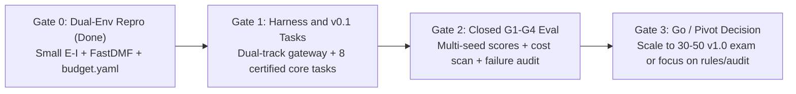

# Phase 0 Task Blueprint and Stage-Gate Plan (v0.1)

This blueprint translates the **NeuroDyn-Bench** North Star into an executable **Phase 0 (6-week pilot)** deliverable plan: building and certifying 10–15 prototype tasks (starting with 8 core cross-environment tasks in Gate 1) together with the dual-track harness and G1–G4 closed evaluation.

---

## 1. Phase 0 Core Deliverables

1. **Dual-Environment Minimal Reproductions (Gate 0 — Completed)**: Verified `Small E-I` (Numba LIF + 6 SNOPS statistics) and canonical C++ `FastDMF` (Schaefer-100 HCP) on `dgx2felis`, resolving OQ-04 (`docs/gate0_report.md`, `configs/budget.yaml`).
2. **Certified Prototype Benchmark Suite (v0.1, Gate 1)**: First batch of **8 core cross-environment tasks** (`T02, T03, T05, T08, T11, T13` on Small E-I; `T04, T14` on FastDMF) plus paired `*_clean` no-trap controls for `T03/T04/T05/T08` and 3-tier disclosure views (`full` / `names_only` / `blinded`), later expanded to 10–15 tasks once collaborator real cases (T09/T15) and AdEx anchors (T01/T10/T12) arrive.
3. **Dual-Track Isolated Harness**: PEtab-style `public/` vs. `private/` loader, unified `SimulatorGateway` + `BudgetLedger` + `trace.jsonl`, Track A optional modular toolbox (optimizers + lightweight Bayesian inference + diagnostic probes), Track B open Python sandbox, and independent Evaluator.
4. **v0.1 Baseline Health Report (Gate 2 -> Gate 3)**: Closed multi-seed evaluation of G1 (raw optimizer), G2 (expert rules), G3 (general tool agent), and G4 (diagnostic agent) with cost-sensitivity curves and failure-mode audits.

---

## 2. Phase 0 Task Blueprint (T01–T15; Gate 1 Core 8 Highlighted)

| ID | Carrier Model | Task Type | Primary Syllabus Module | Core Injected Challenge / Scientific Regime | Expected Diagnostic & Decision Path | Gate 1 Status |
| --- | --- | --- | --- | --- | --- | --- |
| **T01** | AdEx single neuron (anchor) | Type 1 Routine | M1/M2 efficiency | Clean setup aligned with Neuroptimus | Optimize directly without wasting diagnostic budget | Gate 1.5 |
| **T02** | Small E-I (CBN) | Type 1 Routine | M1/M2 efficiency | Clean 4–6D AI regime (`fr_e, isi_cv, ff, rsc, pct_sh`) + held-out `+20%` drive | Run standard optimizer, verify stability, submit | **Gate 1 Core** |
| **T03** | Small E-I (CBN) | Type 2 Recoverable | M1 Setup (dual bounds) | True `g_ei` above `default_ub` (legally expandable inside `phys_hard_ub`) + second parameter near hard bound (`+ T03_clean`) | `boundary_slack` -> verify hard vs. default bounds -> expand legal dim only | **Gate 1 Core** |
| **T04** | FastDMF (16D hetero) | Type 2 Recoverable | M1 Setup (scale + sloppiness) | 8 global + 8 regional FIC multipliers (most regional dims sloppy) + linear scale on log-scale params (`+ T04_clean`) | `sensitivity_screen` to freeze sloppy dims + switch to log scale on stiff dims | **Gate 1 Core** |
| **T05** | Small E-I (CBN) | Type 2 Recoverable | M2 Iteration (variance) | Short-window / high trial-to-trial variance in `rsc` and `pct_sh` swamps single-eval optimizers (`+ T05_clean`) | `repeat_variance` audit -> adaptive repeat averaging on elite candidates | **Gate 1 Core** |
| **T06** | Small E-I (CBN) | Type 2 Recoverable | M2 Iteration (infeasible zone) | >70% default search box falls in silent or runaway phase regions | `short_feasibility_scan` -> enable short-probe screen / recenter box | Gate 1.5 |
| **T07** | FastDMF / Small E-I | Type 2 Recoverable | M1/M2 numerics & weights | Coarse `dt` bias combined with unbalanced observable scales | `timestep_check` + tolerance-normalized objective weighting | Gate 1.5 |
| **T08** | Small E-I (CBN) | Type 2 Ambiguous (Control for T11) | M2/M3 multi-cause stall | Combined slightly narrow bound + elevated repeat noise mimicking an unreachable plateau (`+ T08_clean`) | Cheap discriminative probes exclude 3b conflict -> fix noise & bounds -> pass | **Gate 1 Core** |
| **T09** | FastDMF / Collaborator Case 1 | Type 2 Hard / Real | M1–M3 integrated | Collaborator stalled-then-recovered case (or staged stiff/sloppy FastDMF) | Physical-semantics subset decomposition + held-out validation | Pending OQ-01 |
| **T10** | AdEx / Small E-I | Type 2 + `ask_human` | M1 info gap | Intentionally omitted feature window or input unit convention | Detect missing specification -> targeted `ask_human` -> solve | Gate 1.5 |
| **T11** | Small E-I (CBN fitting SBN) | Type 3b Unreachable | M3 Diagnosis & abstention | Target generated by spatial SBN with spatially correlated input (high `%sh`/`rsc`/`dsh`); solver locked to random CBN | `feature_tradeoff_audit` + `run_ppc_audit` + wide probe -> **abstain `3b_structure_unreachable`** | **Gate 1 Core** |
| **T12** | AdEx (no adaptation fitting adapting target) | Type 3b Unreachable | M3 Diagnosis & abstention | Adapting target vs. non-adapting fixed model | F-I slope vs. adaptation index trade-off -> **abstain `3b`** | Gate 1.5 |
| **T13** | Small E-I (single condition) | Type 3a Non-Identifiable | M3/M4 honesty | Only single-condition `fr_e` and `isi_cv` over `(J_ee, g_ei, tau_i, nu_ext_e)`; equivalent fits diverge under `+30%` drive | `run_abc_smc` / `run_laplace_fisher` / `multistart_identifiability` -> **abstain `3a_non_identifiable`** | **Gate 1 Core** |
| **T14** | FastDMF (static FC only) | Type 3a Non-Identifiable | M3/M4 honesty | Static FC summary inversion over `(G, w, JN, sigma, fic_alpha)` + hetero groups; equivalent fits diverge under `1.25x G` | Low posterior contraction / multi-start parameter drift -> **abstain `3a_non_identifiable`** | **Gate 1 Core** |
| **T15** | Collaborator Case 2 | Level 2/3 Real Capstone | Integrated (Type 2 or 3) | Unpublished real experimental data and stalled workflow from neuroscience collaborators | Independent evaluation under jointly agreed acceptance criteria | Pending OQ-01 |

> **Dev / Test Split Discipline**: Each Gate 1 template generates independent randomized `dev` and `test` instances with disjoint ground-truth regions and RNG seeds. All prompt/rule tuning happens strictly on `dev`; `test` remains frozen for closed Gate 2 evaluation.

---

## 3. Stage-Gate Milestones

- **Gate 0 (Completed for compute & simulators; OQ-01~03 awaiting collaborators)**: Dual minimal reproductions verified on `dgx2felis`; `docs/gate0_report.md` and `configs/budget.yaml` published.
- **Gate 1 (Active)**: Dual-track isolated harness (Track A optional toolbox with lightweight Bayesian inference + Track B open sandbox), 8 core tasks + `*_clean` controls, offline `validation_cert.yaml` proofs (Oracle $\ge 80\%$, 3a degeneracy proof, 3b $\ge 10\times$ budget proof), and G1/G2 reverse screening.
- **Gate 2**: Lock G2/G3/G4 configurations on `dev`, run closed multi-seed evaluation on `test`, and produce headline scoreboard + SimulCost sensitivity curves.
- **Gate 3 (Honesty Gate)**:
  - **Path A**: If G1/G3 struggle clearly on hard Type 2 & Type 3 tasks and G4 yields consistent net gains over G2/G3 -> scale to 30–50 tasks (v1.0) with community lab contributions and small-scale human timing logs.
  - **Path B**: If deterministic rules (G2) already dominate most tasks -> candidly scope claims to the benchmark, empirical failure taxonomy, identifiability/unreachability auditing, and cost-effective rule automation.
